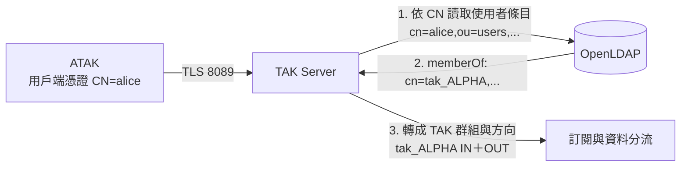

# OpenLDAP 與 TAK Server 群組管理

本頁說明如何讓 TAK Server 依 OpenLDAP（或 Active Directory）的群組成員資格決定 TAK 群組、啟用後各種登入方式的變化，以及對既有用戶端憑證的影響。內容以 2026-11-13 的實驗為準：TAK Server `5.8-RELEASE-84`、`osixia/openldap:1.5.0`、ATAK 5.7.0.17 手機與 5.7.0.15 模擬器，加上以 X509 憑證連 `8089` 的模擬 CoT 用戶端。

**目前狀態：**現行部署仍使用檔案驗證（`UserAuthenticationFile.xml`）。實驗用的 LDAP 容器、設定與憑證都已移除或撤銷；`compose.yaml` 沒有 LDAP 服務。本頁的設定片段是驗證過的範本，正式導入前應改用 LDAPS 並另做備份與回復規劃。



## 1. 運作方式

1. 用戶端以 X509 憑證連到 `8089`。TAK 先驗證憑證鏈與 CRL，這部分和檔案驗證相同。
2. `<auth default="ldap" x509groups="true">` 時，TAK 以憑證 CN 代入 `userstring`，用服務帳號讀取該使用者條目。
3. TAK 從使用者條目的 **`memberOf`** 屬性取得群組。實測 LDAP 記錄只有對使用者條目的 base 查詢（`SRCH base="cn=<CN>,ou=users,..."`），沒有另外搜尋群組；目錄必須能產生 `memberOf`。
4. 只保留符合 `groupprefix` 的群組，再依後綴決定方向：

| LDAP 群組 | TAK 群組與方向 |
| --- | --- |
| `cn=tak_ALPHA` | `tak_ALPHA`：IN＋OUT（Both） |
| `cn=tak_ALPHA_READ` | `tak_ALPHA`：OUT（只讀） |
| `cn=tak_CP_WRITE` | `tak_CP`：IN（只寫） |
| `cn=staff`（沒有 `tak_` 前綴） | 忽略 |

TAK 群組名稱保留 `tak_` 前綴（例如 `tak_ALPHA`），`_READ`／`_WRITE` 後綴會被拿掉並轉成方向；後綴由 `readGroupSuffix`／`writeGroupSuffix` 決定，預設即為 `_READ`、`_WRITE`。

## 2. 準備 OpenLDAP

### 目錄結構

```text
dc=lab,dc=local
├── ou=users      使用者；cn 必須等於 ATAK 用戶端憑證的 CN
│   └── cn=alice
├── ou=groups     TAK 群組；名稱以 tak_ 開頭
│   ├── cn=tak_ALPHA        uniqueMember: cn=alice,ou=users,...
│   └── cn=tak_CP_READ      uniqueMember: ...
└── cn=takread    唯讀服務帳號（osixia 的 LDAP_READONLY_USER）
```

### osixia/openldap 的三個注意事項

- **memberOf**：osixia 預設的 memberOf overlay 只處理 `groupOfUniqueNames`／`uniqueMember`。用 `groupOfNames`／`member` 時使用者條目沒有 `memberOf`，TAK 會把使用者歸到 `__ANON__`（實測）。
- **服務帳號權限**：預設 ACL 不讓一般帳號讀取目錄，自建的 `cn=takbind` 查詢會回 `No such object`。使用映像內建的唯讀帳號：`LDAP_READONLY_USER=true`、`LDAP_READONLY_USER_USERNAME=takread`，DN 為 `cn=takread,<base>`。
- **群組至少一位成員**：`groupOfUniqueNames` 的 `uniqueMember` 為必填。移出群組最後一位成員前，要先放入另一位成員或刪除整個群組。

實驗用的 Compose override（密碼以 `<...>` 表示，放在不進 Git 的檔案）：

```yaml
services:
  lab-ldap:
    image: osixia/openldap:1.5.0
    command: --copy-service
    environment:
      LDAP_ORGANISATION: TAK Lab
      LDAP_DOMAIN: lab.local
      LDAP_ADMIN_PASSWORD: "<admin-password>"
      LDAP_READONLY_USER: "true"
      LDAP_READONLY_USER_USERNAME: takread
      LDAP_READONLY_USER_PASSWORD: "<bind-password>"
      LDAP_TLS: "false"
    volumes:
      - ./ldif:/container/service/slapd/assets/config/bootstrap/ldif/custom:ro
    networks:
      - tak-backend
```

服務放在內部網路 `tak-backend`，TAK 以服務名稱 `lab-ldap` 連線，不發布到主機。啟動後以服務帳號確認 `memberOf`：

```powershell
docker exec <ldap-container> ldapsearch -x -H ldap://localhost `
  -D "cn=takread,dc=lab,dc=local" -W -b "ou=users,dc=lab,dc=local" "(cn=alice)" memberOf
```

## 3. 調整 TAK Server 設定

備份 `runtime/tak/CoreConfig.xml` 後，把 `<auth>` 改成：

```xml
<auth default="ldap" x509groups="true" x509addAnonymous="false" x509checkRevocation="true">
  <File location="UserAuthenticationFile.xml" />
  <ldap url="ldap://lab-ldap:389/" style="DS"
        userstring="cn={username},ou=users,dc=lab,dc=local"
        userBaseRDN="ou=users,dc=lab,dc=local"
        groupBaseRDN="ou=groups,dc=lab,dc=local"
        groupObjectClass="groupOfUniqueNames" userObjectClass="inetOrgPerson"
        groupprefix="cn=tak_" groupNameExtractorRegex="cn=(.*?)(?:,|$)"
        updateinterval="60"
        serviceAccountDN="cn=takread,dc=lab,dc=local"
        serviceAccountCredential="<bind-password>" />
</auth>
```

| 屬性 | 作用與實測結果 |
| --- | --- |
| `default="ldap"` | LDAP 優先。憑證 CN 在目錄中時，檔案中的群組被忽略。 |
| `x509groups="true"` | X509 憑證使用者也到 LDAP 取群組。 |
| `x509addAnonymous="false"` | 預期不加入 `__ANON__`；但 CN 在目錄中、卻沒有任何 `tak_` 群組時，實測仍被歸到 `__ANON__`。 |
| `x509checkRevocation="true"` | 保留原本的 CRL 檢查；撤銷流程不受 LDAP 影響。 |
| `<File>` | 保留檔案驗證。CN 不在目錄中的憑證使用者改用檔案中的群組。 |
| `updateinterval="60"` | 既有連線約 2 分鐘內套用目錄異動。 |
| `groupprefix`／`groupNameExtractorRegex` | 只採用 `tak_` 開頭的群組；名稱取 `cn` 值，保留 `tak_` 前綴。 |

5.8 的 `CoreConfig.xsd` 另有 `nestedGroupLookup`、`readOnlyGroup`、`adminGroup`、`callsignAttribute` 等屬性，本次沒有測試。

套用時要注意：

- **TAK 會改寫設定檔**：啟動時 TAK 會重新排列 `CoreConfig.xml` 的屬性順序。之後再修改時要用 XML 或正規表示式定位，不要以整行字串取代；還原時直接放回備份檔。
- **服務帳號密碼是明文**：`serviceAccountCredential` 以明文存在 `CoreConfig.xml`。服務帳號只給讀取權限，並避免在終端機或紀錄中輸出整行 `<ldap>` 設定。
- **正式環境改用 LDAPS**：連線應改為 `ldaps://`，並設定 `ldapsTruststore*` 屬性。實驗中的 LDAP 只在 Docker 內部網路使用明文 `389`。

最後執行 `docker compose restart tak-server`，等待 healthy。

## 4. 驗證實際分配的群組

使用者管理 API（控制台的群組頁也用它）**只看得到檔案中的使用者與群組**，不能用來確認 LDAP 群組；不在檔案中的使用者會回 HTTP 500。請改看目前連線的訂閱：

```text
GET https://<tak>:8443/Marti/api/subscriptions/all?page=-1&limit=-1
```

以管理員憑證呼叫，回應中每條連線的 `username` 與 `groups`（名稱及 `IN`／`OUT`）就是 TAK 實際使用的群組。若都是 `__ANON__`，依序檢查：使用者條目有沒有 `memberOf`、`groupprefix` 是否相符、服務帳號能否讀到該條目。

## 5. 群組管理操作

| 工作 | 在 LDAP 的操作 | 生效時機（實測） |
| --- | --- | --- |
| 新人加入 Alpha | 建立 `cn=<CN>` 使用者並加入 `tak_ALPHA` | 新連線立即生效 |
| 指揮所監看各單位 | 加入 `tak_CP`、`tak_ALPHA_READ`、`tak_BRAVO_READ` | 新連線立即生效 |
| 觀察哨只回報 | 加入 `tak_OP`、`tak_CP_WRITE` | 新連線立即生效 |
| 唯讀評核員 | 只加入各單位的 `_READ` 群組 | 新連線立即生效；評核員沒有 IN 群組，沒人看得到他 |
| 臨時聯合任務 | 建立 `tak_JOINT1`，加入相關成員 | 新連線立即生效；既有連線約 2 分鐘內加入 |
| 人員調動 | 從 `tak_ALPHA` 移出、加入 `tak_BRAVO` | 不重發憑證、不重啟 TAK；既有連線約 2 分鐘內換到 `tak_BRAVO` |
| 人員離隊 | 移出所有 `tak_` 群組 | 會落入 `__ANON__`，見第 7 節；停權請撤銷憑證 |

以上情境（1-1、2 與評核員、聯合任務、調動）都以模擬用戶端驗證可見度；1-1 加情境 2 的組合另以手機（CP）與模擬器（Alpha）實機確認。

## 6. 啟用後的登入變化

| 登入或存取方式 | 啟用 LDAP 後 |
| --- | --- |
| ATAK／WinTAK 以用戶端憑證連 `8089` | 仍以憑證驗證身分與撤銷狀態；群組改由 LDAP 依 CN 決定（實測）。裝置端設定與 DPK 不必修改。 |
| 管理員憑證連 `8443`（管理 API、健康檢查） | 正常運作（實測）。TAK 會以 `cn=admin` 到 LDAP 查詢，查不到也不影響管理權限。 |
| 憑證控制台的群組頁、群組修改 | 只讀寫檔案中的群組。CN 在 LDAP 中的使用者，在控制台看到或修改的群組都**不會生效**；不在檔案中的使用者，讀取會失敗（HTTP 500）。 |
| 使用者名稱／密碼登入（WebTAK、`8446`、憑證註冊 enrollment） | 依 TAK 設計會改用 LDAP 帳密；**未實測**。本專案目前也沒有發布 `8446`。 |

## 7. 對既有憑證與使用者的影響

| 情況 | 實測結果 |
| --- | --- |
| 憑證 CN 在 LDAP 中，且有 `tak_` 群組；同時也登錄在 `UserAuthenticationFile.xml` | 採用 LDAP 群組，檔案中的群組被忽略。 |
| 憑證 CN 在 LDAP 中，但沒有任何 `tak_` 群組 | 歸到 `__ANON__`（即使設了 `x509addAnonymous="false"`）。依群組規則，這類使用者與其他 `__ANON__` 連線會彼此可見（推論；實測只有一位這類使用者）。 |
| 憑證 CN 不在 LDAP 中（例如既有的裝置憑證） | 退回檔案中的群組，原本的分組照常運作。 |
| 憑證已撤銷 | `x509checkRevocation` 設定不變；撤銷後拒絕連線是在還原成檔案驗證後確認的，LDAP 啟用期間**未實測**。 |

導入建議：

- 為每位使用者建立與憑證 CN 相同的 LDAP 帳號，並指派至少一個 `tak_` 群組。
- 移除某人的所有 `tak_` 群組不等於停權；要停權，撤銷憑證。
- 導入期間，檔案登錄可當成目錄外憑證的備援；完成遷移後再檢查哪些 CN 仍只靠檔案群組。
- 控制台的群組功能對 LDAP 使用者無效，應在介面或操作手冊中註明，避免管理者以為修改已生效。

## 8. 還原成檔案驗證

1. 放回 `CoreConfig.xml` 備份（還原後可比對雜湊值）。
2. `docker compose up -d tak-server` 並等待 healthy；確認 `docker port` 只剩原本的通訊埠。
3. 移除 LDAP 容器，例如 `docker compose -f compose.yaml -f <override> rm -sf lab-ldap`。
4. 以訂閱 API 確認連線回到檔案中的群組。

實驗時 TAK 曾改寫 `CoreConfig.xml`，但放回備份並重新啟動後，雜湊值與修改前相同。

## 9. 驗證範圍

已實測：

- LDAP 群組與方向對應、`groupOfUniqueNames` 與 `memberOf` 的必要性、服務帳號權限。
- 情境 1-1 加情境 2 的組合（模擬用戶端與兩台裝置），以及唯讀評核員、臨時聯合任務、人員調動（模擬用戶端）。
- 檔案群組與 LDAP 群組的優先順序、目錄中無群組或不在目錄中的使用者。

未實測：

- LDAPS、Active Directory（`style="AD"`）與巢狀群組。
- 使用者名稱／密碼登入、WebTAK、`8446`、憑證註冊。
- `adminGroup`、`readOnlyGroup` 等其他屬性，以及大量使用者時的效能。

依據：atak-manager 專案的 `docs/test-records/2026-11-13-tak-groups-lab.md`、[TAK Server 維運](operations.md)、[用戶端憑證控制台](certificate-console.md)。
