# 2026-11-20 以 NFC 交付裝置憑證 DPK

## 結論

1. **ATAK 的 `/import` 深層連結可以改由 NFC 交付。**PN532 模擬一個 NFC 標籤，內容是分享頁產生的 `tak://com.atakmap.app/import?url=...` 連結。Android 手機感應後，ATAK 下載並匯入裝置憑證 DPK，並連上 `takbox.local:8089:ssl`。
2. **流程與 QR 相同，只是多經過 Android 的 Tags App。**ATAK 沒有登記接收 NFC 標籤：感應後 Android 先顯示 **Choose an action**，選 Tags，再點 `tak:` 連結交給 ATAK。
3. **標籤只放下載網址，DPK 不在標籤內。**NDEF 訊息只有 145 bytes，不受標籤容量限制；但分享有效期間任何人讀到標籤，都能下載含裝置私鑰的 DPK。
4. **`/enroll` 無法在本機環境測試。**bootstrap 移除了 `8446` connector，伺服器沒有憑證註冊入口。
5. **憑證工作佇列以 `.env` 的 `TAK_BIND_IP` 驗證註冊。**位址與實際綁定不同時，簽發會停在「已簽發、DPK 已建立，但 TAK 註冊未驗證」；修正 `.env` 後以群組設定重新註冊即通過。

## 測試環境

▲ Windows 主機經 USB 驅動 PN532 模擬標籤；手機讀到連結後，經熱點向 share-public 下載 DPK，再連上 tak-server 的 8089。

- TAK Server `5.8-RELEASE-92`（hardened），Windows Docker Desktop，檔案驗證模式。
- 網路：Windows 行動熱點。主機與手機在同一網段，`takbox.local` 由 Windows mDNS responder 解析。
- 標籤：PN532 以 NFC Forum Type 4 Tag（ISO-DEP）模擬，唯讀，不是實體標籤。模擬程式為 NTAG Reader 專案的 `emulate_ndef` 範例。
- 手機：一支 Android 手機，安裝 ATAK-CIV；感應時手機已解鎖並連上熱點。
- 測試憑證：以憑證工作佇列簽發一日效期憑證，群組為 `team-alpha`（IN＋OUT）與 `team-all`（OUT），與控制台「新增 TAK 用戶端」的預設相同。
- 分享：控制台憑證分享的預設條件，20 分鐘、最多下載 3 次。

本紀錄不含密碼、分享 token、實際位址、憑證序號、指紋或裝置識別資訊。

## 步驟與結果

| 步驟 | 結果 |
| --- | --- |
| 依熱點位址啟動 Compose、更新防火牆與 mDNS | 容器全部 healthy；`8089`、`8443`、`10065` 綁在熱點位址；主機解析 `takbox.local` 正確 |
| 憑證工作佇列 `issue` | 憑證已簽發、DPK 已建立，使用者已寫入 `UserAuthenticationFile.xml` 且 TAK 已重啟；但驗證失敗，見下節 |
| 修正 `.env` 後以 `groups` 重新註冊 | TAK API 讀回 `team-alpha` 與 `team-all`，登記為已註冊 |
| 建立分享 | 得到 `tak://com.atakmap.app/import?url=http%3A%2F%2Ftakbox.local%3A10065%2Fd%2F...%2FAlpha_....dpk`，140 字元，NDEF 訊息 145 bytes |
| PN532 模擬標籤，手機感應 | 手機兩次讀取，每次 190 ms 讀完；Android 顯示 NFC 選單 |
| Tags → 點連結 → ATAK 確認匯入 | ATAK 將 `cert/clientCert.p12`、`cert/caCert.p12` 解壓到 `atak/tools/datapackage/files/` 下 |
| 連線 | ATAK logcat 持續顯示 `connect_string=takbox.local:8089:ssl ... connected=true`，並與伺服器互相送出 ping |
| 收尾 | 提前停止分享；停止 PN532 模擬 |

判定依據是手機的 logcat：DPK 解壓縮與連線狀態的時間點一致。TAK 伺服器紀錄沒有記下這個 CN 的連線；專案的 API 用戶端不允許查詢 `subscriptions/all`，因此伺服器端沒有另外讀回目前連線清單。

## 註冊驗證失敗的原因

測試開始時 `.env` 的 `TAK_BIND_IP` 是先前網段的位址，主機已沒有這個位址。Compose 與防火牆、mDNS 腳本以環境變數改用熱點位址，但 Windows 端的憑證工作佇列讀 `.env`：

- `wait_for_cot_listener()` 以 `bind_ip()` 連 `8089`，連不到。
- `tak_api_client` 也以 `bind_ip()` 連 `8443`，查群組逾時。

結果是簽發回應 `signed and DPK created, but TAK registration is unverified`，登記冊的 `registered` 為 `false`，控制台不允許建立分享。修正 `.env` 後，以 `groups` 動作送出相同群組；工作佇列重寫使用者、重啟 TAK、讀回群組，登記為已註冊。

換網段時，先改 `.env` 再啟動 Compose，不要只用環境變數覆寫。

## 安全界線

- 讀到標籤的人，在分享有效期間都能下載含裝置私鑰與匯入密碼的 DPK。每台裝置使用自己的分享，設短效、限次數，交付後立即停止；不要把這種標籤張貼在公共區域。
- 分享頁是 HTTP，只在受控熱點使用。
- 測試憑證效期到 2026-11-21；不再需要時在控制台的憑證清冊撤銷。

## 未測試

- `/enroll`（伺服器沒有 `8446`）。
- 實體 NFC 標籤上的 `/import`：本次是模擬標籤。實體 NTAG215 只測過 `/preference`。
- 其他手機與 iPhone。
- 伺服器端讀回這個憑證的連線。
